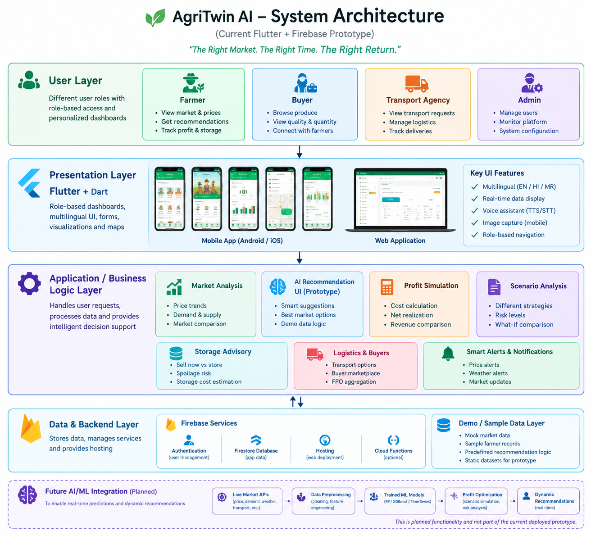
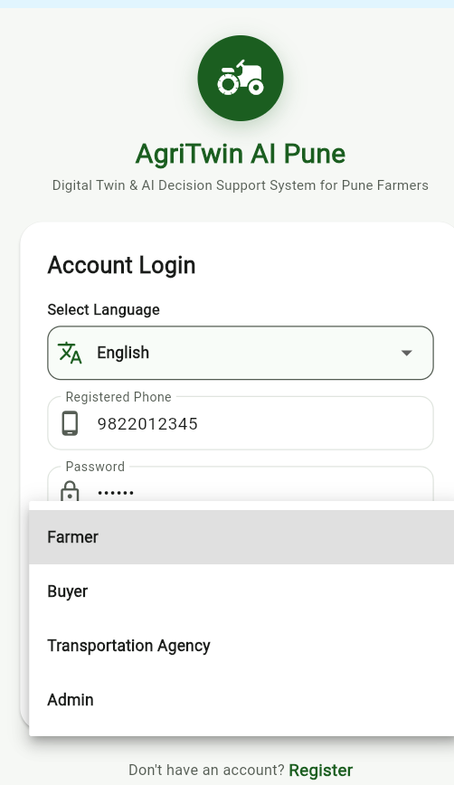
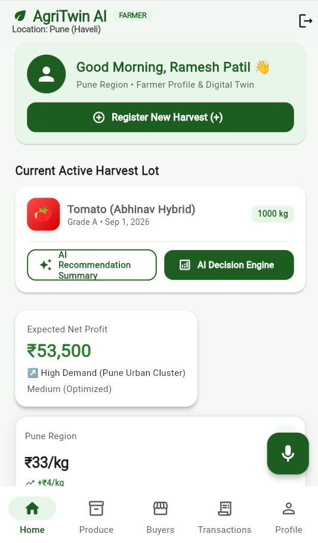
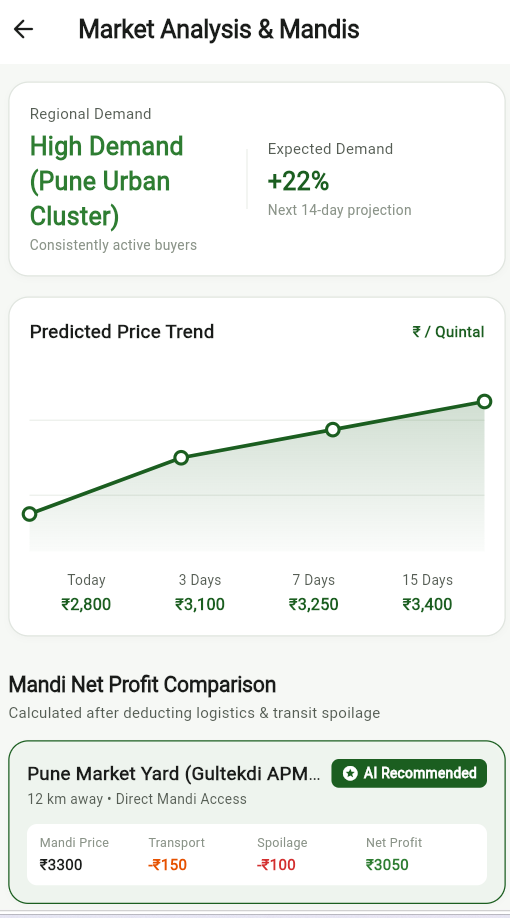
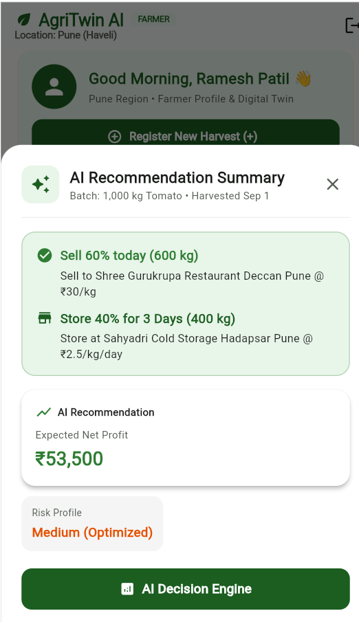
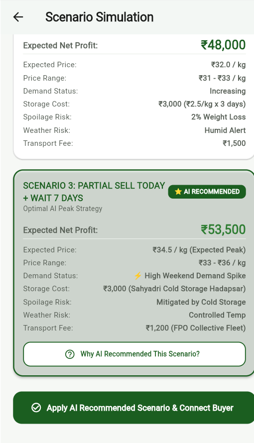
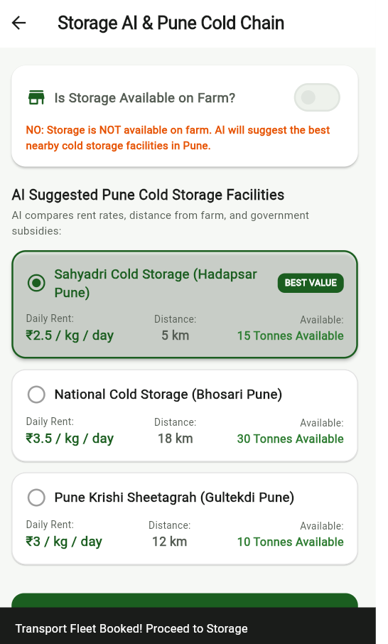
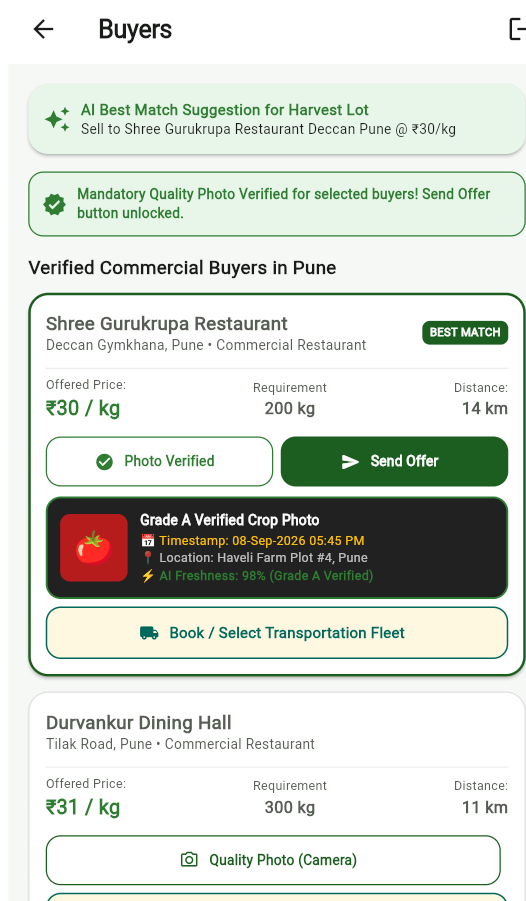
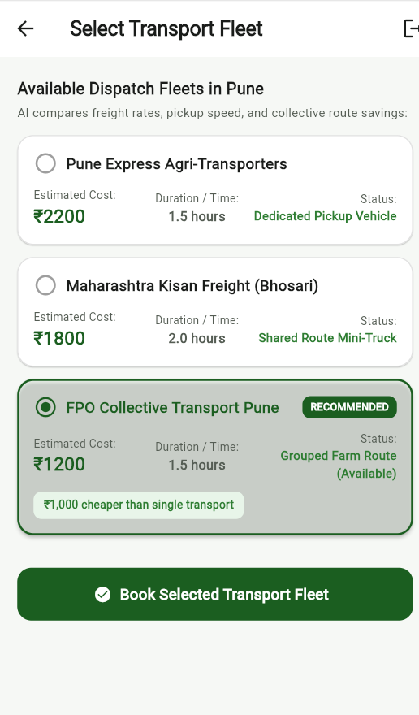

# 🌾 AgriTwin AI
### The Right Market. The Right Time. The Right Return.

**An AI-powered agricultural market intelligence and profit optimization platform designed to help farmers make smarter, data-driven selling decisions.**

[🌐 Live Demo](https://agritwin-ai-d4ed8.web.app/) | [💻 GitHub Repository](https://github.com/sanskrutidalavi-pixel/AgriTwin-AI)

---

## 📌 Problem Statement

Farmers often make selling decisions based on current mandi prices without considering transportation costs, storage expenses, spoilage risks, market demand and future price fluctuations.

A higher market price does not always guarantee higher profit.

AgriTwin AI addresses this challenge by focusing on **Net Realization (Actual Farmer Profit)** rather than simply displaying market prices.

## 💡 Our Solution

AgriTwin AI is a decision-support platform that helps farmers evaluate different selling scenarios and make informed decisions about:

- Where to sell their produce.
- When to sell for better returns.
- Whether to sell immediately or store produce.
- How transportation and storage costs affect profitability.
- How different market conditions influence selling decisions.

## ✨ Key Features

- **Market Intelligence:** Explore agricultural market information and compare selling opportunities.
- **AI Decision Support:** Recommendation interface for smarter selling decisions.
- **Profit Simulation:** Compare potential returns after considering associated costs.
- **Scenario Analysis:** Evaluate alternative selling strategies.
- **Storage Advisory:** Assess sell-now versus store-and-sell-later options.
- **Logistics Management:** Explore transportation-related options.
- **Multilingual Interface:** Support for English, Hindi and Marathi.
- **Role-Based Interfaces:** Farmer, Buyer, Transport Agency and Admin.

*Note: AI-related screens and recommendations may use prototype or demonstration data. Live prediction capabilities depend on the connected model and data services.*

## 🛠️ Technology Stack

| Technology | Purpose |
|---|---|
| Flutter | Cross-platform application development |
| Dart | Application programming language |
| Firebase | Application hosting and backend services |
| Git & GitHub | Version control and source-code management |

## 🏗️ System Architecture

AgriTwin AI follows a modular Flutter-based architecture, separating the presentation layer, business logic, data management and hosting services.

The current prototype uses sample agricultural datasets and predefined recommendation logic to demonstrate its decision-support capabilities.

Future enhancements include real-time market data integration, trained machine learning models and dynamic profit optimization.


## 📸 Application Screenshots


## 📸 Application Screenshots

### 1. Role Selection


### 2. Farmer Dashboard


### 3. Market Comparison


### 4. AI-Powered Recommendation (Prototype)
## 📸 Application Screenshots

### 1. Role Selection


### 2. Farmer Dashboard


### 3. Market Comparison


### 4. AI-Powered Recommendation (Prototype)


### 5. Recommendation Explanation


### 6. Scenario Analysis


### 7. Storage Advisory


### 8. Buyer Marketplace


### 9. Logistics Management



### 5. Recommendation Explanation


### 6. Scenario Analysis


### 7. Storage Advisory


### 8. Buyer Marketplace


### 9. Logistics Management

 

## 🚀 Getting Started

### Prerequisites

- Flutter SDK
- Dart SDK
- VS Code or Android Studio
- A supported device or browser

### Installation

**1. Clone the repository**

```bash
git clone https://github.com/sanskrutidalavi-pixel/AgriTwin-AI.git
```

**2. Navigate to the project directory**

```bash
cd AgriTwin-AI
```

**3. Install dependencies**

```bash
flutter pub get
```

**4. Run the application**

```bash
flutter run
```

For web development:

```bash
flutter run -d chrome
```

Some mobile-specific features may have limited functionality in the web version.

## 🌐 Live Demo

Experience AgriTwin AI:

https://agritwin-ai-d4ed8.web.app/

## 🎯 Project Vision

To empower farmers with accessible, intelligent and transparent agricultural decision-support tools that prioritize profitability, reduce avoidable losses and strengthen market linkages.

---

**AgriTwin AI — The Right Market. The Right Time. The Right Return.**